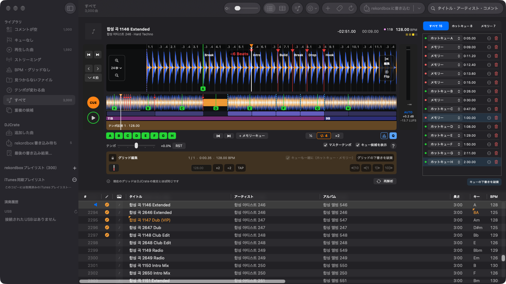
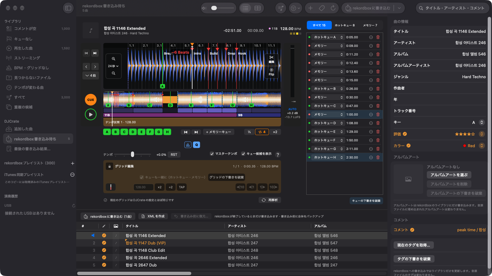
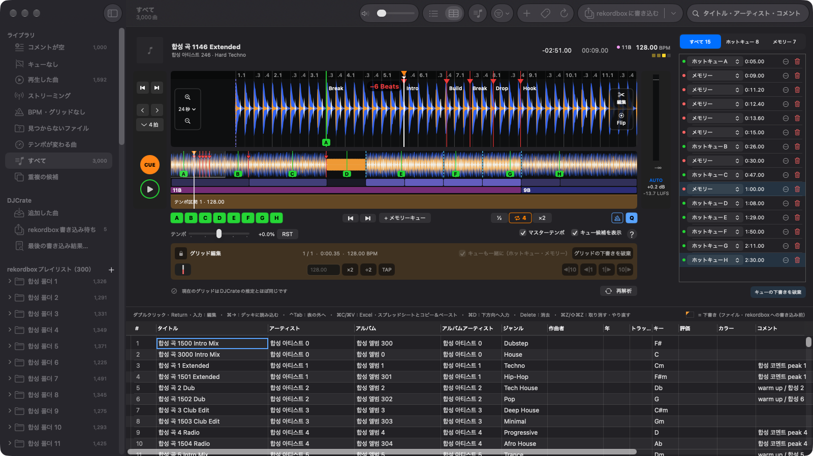

# DJCrate

[](https://github.com/fotoner/DJCrate/actions/workflows/check.yml) [](LICENSE)

[한국어](README.md) | [English](README.en.md) | **日本語** | [简体中文](README.zh-CN.md)

> [!WARNING]
> DJCrate はまだ **ベータ版**（0.x）のため、予期しない問題が起きる可能性があります。
>
> DJCrate は rekordbox に書き込む前に、ライブラリ全体を自動でバックアップします。書き込んだ後に問題が起きたときは、ツールバーの [rekordboxに書き込む] メニューにある [書き込み前に復元…] で元に戻してください。それでも問題が残る場合は、[Issues](https://github.com/fotoner/DJCrate/issues) からご連絡ください。
>
> DJCrate は [MIT ライセンス](LICENSE)に基づき「現状のまま」提供されます。使用中に生じたデータの損失や損害について、開発者は責任を負いません。

DJCrate は、rekordbox を起動せずに rekordbox 7 のライブラリを編集できる macOS アプリです。演奏用ではなく、ライブラリ管理のためのツールです。コマンドラインツール `djc` も同梱しています。アプリの画面は韓国語・英語・日本語に対応しています。

> [!NOTE]
> ドキュメント（`docs/…`）、`djc` の出力、GitHub の Issue は韓国語です。下のリンクは韓国語のドキュメントを指します。



## 安全のための原則

- 編集はすべて下書きとして保存されます。rekordbox に書き込むのは [rekordboxに書き込む] を押したときだけです。ショートカットは ⇧⌘E です。
- rekordbox または rekordboxAgent が起動している間は書き込みません。
- 確認済みのバージョン（7.2.x）とデータベース構造でなければ書き込みません。
- 書き込む前にライブラリ全体をバックアップします。1 つのトランザクションで書き込んだ後、読み直して検証します。
- [書き込み前に復元…] で元に戻せます。
- rekordbox で同じ編集をした結果と項目単位で一致することを確認した書き込みだけを行います。それ以外はブロックし、その理由を画面に表示します。



## インストールと実行

ビルド済みのアプリ（ベータ版、Apple Silicon）は [GitHub Releases](https://github.com/fotoner/DJCrate/releases) から入手できます。ダウンロードしたアプリのインストール手順は[リリースのドキュメント](docs/releasing.md#설치)にあります。

アプリは新しいバージョンを自動で確認してお知らせします。署名を確認してからインストールし、rekordbox や USB への書き込み中はインストールを待ちます。自動確認と自動インストールは 設定 › [アップデート] で選べます。v0.1.0 にはこの機能がないため、次のバージョンは一度だけ手動でインストールしてください。

ソースからビルドするには、次のものが必要です。

- macOS 27 以降
- Swift 6.2 以降（Xcode）
- rekordbox 7.2.x（7.2.18 で確認）

```bash
git clone https://github.com/fotoner/DJCrate.git && cd DJCrate
scripts/build-app.sh --install        # /Applications/DJCrate.app
swift build -c release --product djc  # .build/release/djc
```

1. ツールバーの ⟳ [rekordboxと同期] でライブラリのコピー（スナップショット）を作ります。ショートカットは ⌘R です。rekordbox は起動したままでかまいません。
2. デッキや曲リストで編集します。編集した曲には書き込み待ちの印が付き、サイドバーの [rekordbox書き込み待ち] に集まります。
3. rekordbox と rekordboxAgent を完全に終了します。
4. [rekordboxに書き込む] を押します。DJCrate はまずコピーに試し書きします。ブロックされるものや抜け落ちるものがある場合だけ、確認ダイアログにその一覧を表示します。それ以外はそのまま書き込みます。
5. 元に戻すには、結果の通知にある [書き込み前に復元] を押します。

コピー・下書き・バックアップは `~/Library/Application Support/DJCrate/` にあります。ここにはクラウドのトークンが含まれるため、共有しないでください。

## 機能

| 分類 | 機能 |
|---|---|
| ライブラリ | プレイリストツリー、フィルター（キューなし・グリッドなし・見つからないファイルなど）、見つからないファイルの移動先候補（読み取りのみ）、重複曲の統合、曲の追加・削除、iTunes 同期プレイリスト |
| デッキ | 3 バンド波形、CUE・ホットキュー・メモリーキュー、サンプル単位のループ、クオンタイズ、テンポとマスターテンポ（キーロック）、メトロノーム、オートゲイン、キュー・グリッド・ゲイン・キーの提案 |
| 編集 | キュー、グリッド・BPM（テンポが変わる曲を含む）、ゲイン、タグ、評価・カラー、アルバムアート。表計算のように編集できるタグシート。未解析の曲には解析ファイルを作って付けます |
| トラック編集・Flip（試験的） | 小節単位で切り貼りした編集版や、ホットキューのジャンプ・ループ演奏を写した編集版を WAV で作り、ライブラリに追加します |
| プレイリスト | プレイリスト・フォルダの作成、名前の変更、移動、削除、曲の追加・削除、並べ替え。サイドバーで ⌘・⇧ クリックして複数をまとめて削除・移動できます |
| 演奏履歴 | 演奏履歴の表示、履歴からプレイリストを作成。CDJ・XDJ が USB に残した履歴を保存し、rekordbox の演奏履歴に追加します |
| XML | rekordbox に取り込む連携 XML、ライブラリ全体の XML エクスポート（読み取りのみ）、rekordbox XML の読み込み（差分を確認してから下書きに）、Apple Music XML の読み込み |
| USB（試験的） | OneLibrary・Device Library の読み込み・エクスポート・編集・同期、古い USB への OneLibrary の追加。実物の USB には、[USBにエクスポート] シートか書き込み確認ダイアログで書き込みを確定したときだけ書き込みます（書き込み前にバックアップ、書き込み後に検証） |
| 元に戻す | 書き込み前に復元、復元ポイント（1 日 1 回自動作成、現在との比較、その時点への復元）、ブロックされた下書きの修正 |
| アップデート | GitHub Releases で新しいバージョンを見つけてお知らせし、署名を確認してからインストールします。設定 › [アップデート] |
| ラボ | インテリジェントプレイリストの表示（読み取りのみ）。設定 › [ラボ] でオンにします |
| CLI・エージェント | `djc` でライブラリを調べ、キュー・タグ・プレイリストの下書きを作れます。XML・USB・復元ポイントのコマンドもあります。Claude Code・Codex 用の[スキル](skills/djcrate/SKILL.md)と `djc` は 設定 › [AIエージェント] でインストール・更新します |



## ドキュメント

| ドキュメント | 内容 |
|---|---|
| [docs/features.md](docs/features.md) | 機能の詳細、制限、XML の流れ、ショートカット |
| [docs/cli.md](docs/cli.md) | `djc` のコマンドと JSON |
| [docs/rekordbox-internals.md](docs/rekordbox-internals.md) | 実験で確認した rekordbox の書き込みルール |
| [docs/usb-internals.md](docs/usb-internals.md) | USB の形式と書き込みルール |
| [docs/architecture.md](docs/architecture.md) | 構造と設計上の判断 |
| [CONTRIBUTING.md](CONTRIBUTING.md) · [AGENTS.md](AGENTS.md) · [docs/issues.md](docs/issues.md) | ビルドと検証、作業ルール、[GitHub Issue](https://github.com/fotoner/DJCrate/issues) のルール |

## ライセンス

- ライセンスは [MIT](LICENSE) です。サードパーティーの表記は [THIRD_PARTY_NOTICES.md](THIRD_PARTY_NOTICES.md) にあります。
- rekordbox は AlphaTheta の商標です。このアプリは AlphaTheta とは関係のない独立したプロジェクトです。
- rekordbox のデータベースの鍵は、[pyrekordbox](https://github.com/dylanljones/pyrekordbox)（MIT）と同じ方法で復号します。
