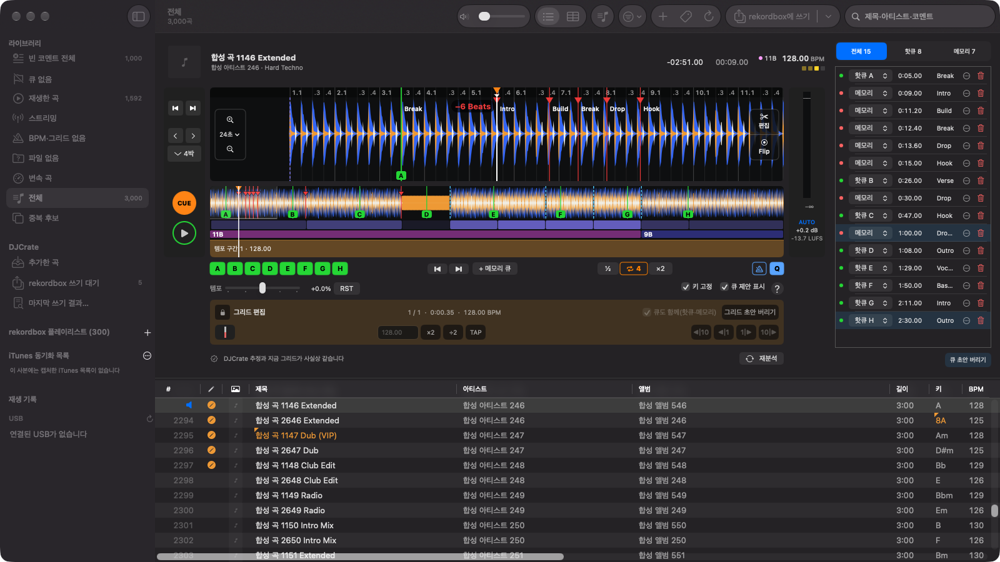
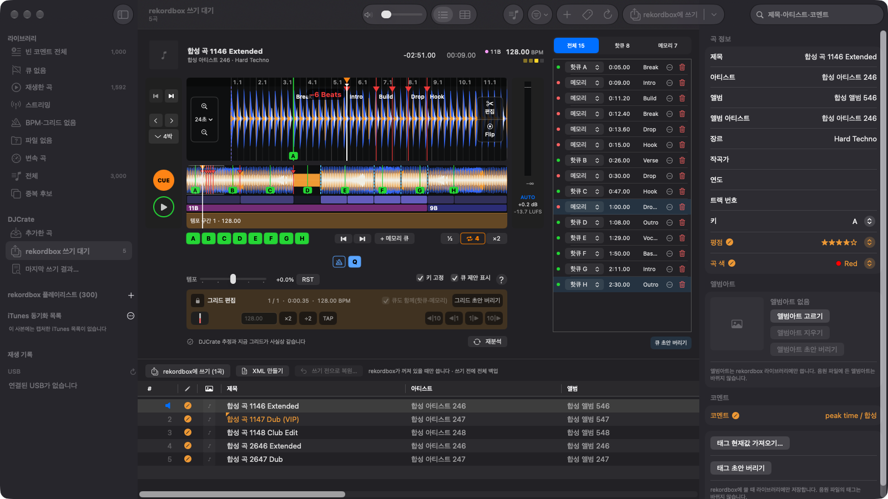
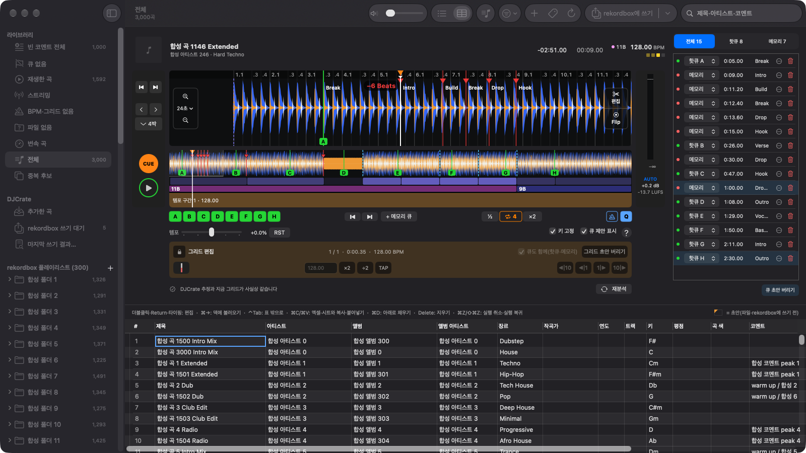

# DJCrate

[](https://github.com/fotoner/DJCrate/actions/workflows/check.yml) [](LICENSE)

**한국어** | [English](README.en.md) | [日本語](README.ja.md) | [简体中文](README.zh-CN.md)

> [!WARNING]
> DJCrate는 아직 **베타**(0.x)라서 예상하지 못한 문제가 생길 수 있습니다.
>
> DJCrate는 rekordbox에 쓰기 전에 라이브러리 전체를 자동으로 백업합니다. 쓴 뒤 문제가 생기면 툴바 [rekordbox에 쓰기] 메뉴의 [쓰기 전으로 복원…]으로 되돌려 주세요. 그래도 문제가 남으면 [이슈](https://github.com/fotoner/DJCrate/issues)로 연락해 주세요.
>
> DJCrate는 [MIT 라이선스](LICENSE)에 따라 있는 그대로 제공됩니다. 사용 중 생긴 데이터 손실이나 손해는 개발자가 책임지지 않습니다.

DJCrate는 rekordbox 7 라이브러리를 고치는 macOS 앱이다. 고칠 때 rekordbox를 켤 필요가 없다. 공연용이 아니라 라이브러리 관리 도구다. 명령줄 도구 `djc`도 함께 있다. 화면은 한국어·영어·일본어로 볼 수 있다.



## 안전 원칙

- 편집은 모두 초안으로 쌓인다. [rekordbox에 쓰기]를 누를 때만 rekordbox에 쓴다. 단축키는 ⇧⌘E다.
- rekordbox나 rekordboxAgent가 켜져 있으면 쓰지 않는다.
- 확인한 버전(7.2.x)과 DB 구조가 아니면 쓰지 않는다.
- 쓰기 전에 라이브러리 전체를 백업한다. 한 트랜잭션으로 쓴 뒤 다시 읽어 검증한다.
- [쓰기 전으로 복원…]으로 되돌릴 수 있다.
- rekordbox에서 직접 편집한 결과와 칸 단위로 같은지 확인한 쓰기만 한다. 나머지는 막는다. 막은 이유는 화면에 보여 준다.



## 설치와 실행

빌드한 앱(베타, Apple Silicon)은 [GitHub Releases](https://github.com/fotoner/DJCrate/releases)에서 받는다. 받은 앱의 설치 절차는 [배포 문서](docs/releasing.md#설치)에 있다.

앱은 새 버전을 스스로 찾아 알린다. 업데이트는 서명을 확인한 뒤에만 설치한다. rekordbox·USB에 쓰는 중이면 설치를 미룬다. 설정 › [업데이트]에서 자동 확인과 자동 설치를 고른다. v0.1.0에는 이 기능이 없으니 다음 버전을 한 번 직접 받아 설치한다.

소스에서 빌드할 때 필요한 것은 아래와 같다.

- macOS 27 이상
- Swift 6.2 이상(Xcode)
- rekordbox 7.2.x(7.2.18에서 확인)

```bash
git clone https://github.com/fotoner/DJCrate.git && cd DJCrate
scripts/build-app.sh --install        # /Applications/DJCrate.app
swift build -c release --product djc  # .build/release/djc
```

1. 툴바의 ⟳ [rekordbox와 동기화]로 라이브러리 사본(스냅샷)을 뜬다. 단축키는 ⌘R이다. rekordbox가 켜져 있어도 된다.
2. 덱·목록에서 고친다. 고친 곡에는 쓰기 대기 표시가 붙는다. 사이드바 [rekordbox 쓰기 대기]에 그 곡이 모인다.
3. rekordbox와 rekordboxAgent를 완전히 끈다.
4. [rekordbox에 쓰기]를 누른다. DJCrate는 사본에 미리 써 본다. 막힌 것이나 빠지는 것이 있을 때만 확인 창에 그 목록을 보인다. 그 밖에는 바로 쓴다.
5. 되돌리려면 결과 알림의 [쓰기 전으로 복원]을 누른다.

사본·초안·백업은 `~/Library/Application Support/DJCrate/`에 있다. 여기에는 클라우드 토큰이 들어 있으니 공유하지 않는다.

## 기능

| 영역 | 기능 |
|---|---|
| 라이브러리 | 재생 목록 트리, 필터(큐 없음·그리드 없음·파일 없음 등), 파일 없는 곡의 새 위치 후보(읽기만), 중복 곡 합치기, 곡 넣기·빼기, iTunes 동기화 목록 |
| 덱 | 3밴드 파형, CUE·핫큐·메모리 큐, 샘플 단위 루프, 퀀타이즈, 템포·키 고정, 메트로놈, 오토게인, 큐·그리드·게인·키 제안 |
| 편집 | 큐, 그리드·BPM(변속 곡 포함), 게인, 태그, 평점·곡 색, 앨범아트. 표처럼 고치는 태그 시트. 분석 전 곡은 분석 파일을 만들어 붙인다 |
| 곡 편집·Flip(시험) | 마디 단위로 잘라 붙인 편집본, 핫큐 점프·루프 연주를 옮긴 편집본을 WAV로 만들어 넣는다 |
| 재생 목록 | 목록·폴더 만들기, 이름 바꾸기, 옮기기, 지우기, 곡 넣고 빼기, 순서 바꾸기. 사이드바에서 ⌘·⇧ 클릭으로 여러 개를 골라 한 번에 지우고 옮긴다 |
| 재생 기록 | 재생 기록 보기, 기록으로 재생 목록 만들기. CDJ·XDJ가 USB에 남긴 기록을 보존한 뒤 rekordbox 재생 기록에 넣는다 |
| XML | rekordbox로 가져오는 연동 XML, 라이브러리 전체 XML 내보내기(읽기만), rekordbox XML 가져오기(차이를 미리 본 뒤 초안으로), Apple Music XML 가져오기 |
| USB(시험) | OneLibrary·Device Library 읽기·내보내기·편집·동기화, 옛 USB에 OneLibrary 더하기. 실물 USB에는 [USB로 내보내기] 시트나 쓰기 확인 창에서 쓰기를 확인했을 때만 쓴다(쓰기 전 백업·쓴 뒤 검증) |
| 되돌리기 | 쓰기 전으로 복원, 시점 스냅샷(하루 한 번 자동, 현재와 비교, 그 시점으로 복원), 막힌 초안 고치기 |
| 업데이트 | GitHub Releases에서 새 버전을 찾아 알리고, 서명을 확인한 뒤 설치한다. 설정 › [업데이트] |
| 실험실 | 인텔리전트 재생 목록 보기(읽기만). 설정 › [실험실]에서 켠다 |
| CLI·에이전트 | `djc`로 라이브러리를 찾아보고 큐·태그·재생 목록 초안을 만든다. XML·USB·시점 스냅샷 명령도 있다. Claude Code·Codex용 [스킬](skills/djcrate/SKILL.md)과 `djc`는 설정 › [AI 에이전트]에서 설치한다 |



## 문서

| 문서 | 내용 |
|---|---|
| [docs/features.md](docs/features.md) | 기능 자세히, 한계, XML 경로, 단축키 |
| [docs/cli.md](docs/cli.md) | `djc` 명령과 JSON |
| [docs/rekordbox-internals.md](docs/rekordbox-internals.md) | 실험으로 확인한 rekordbox 쓰기 규칙 |
| [docs/usb-internals.md](docs/usb-internals.md) | USB 형식과 쓰기 규칙 |
| [docs/architecture.md](docs/architecture.md) | 구조와 설계 결정 |
| [CONTRIBUTING.md](CONTRIBUTING.md) · [AGENTS.md](AGENTS.md) · [docs/issues.md](docs/issues.md) | 빌드·검증, 작업 규칙, [GitHub 이슈](https://github.com/fotoner/DJCrate/issues) 규칙 |

## 라이선스

- 라이선스는 [MIT](LICENSE)다. 제3자 고지는 [THIRD_PARTY_NOTICES.md](THIRD_PARTY_NOTICES.md)에 있다.
- rekordbox는 AlphaTheta의 상표다. 이 앱은 AlphaTheta와 관계없는 독립 프로젝트다.
- rekordbox DB 키는 [pyrekordbox](https://github.com/dylanljones/pyrekordbox)(MIT)와 같은 방식으로 푼다.
