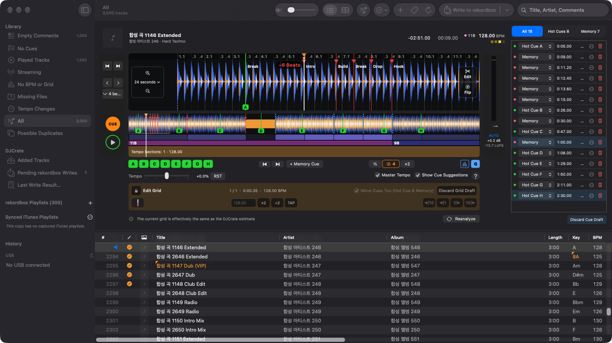
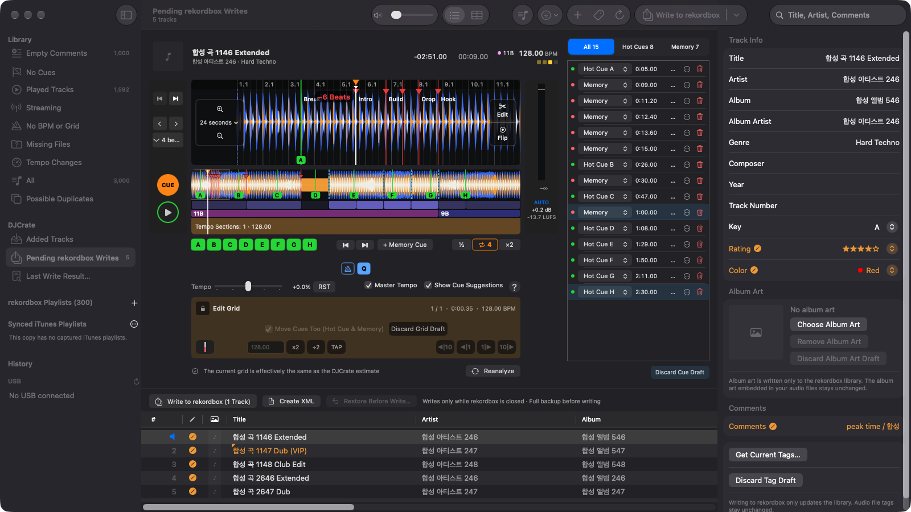
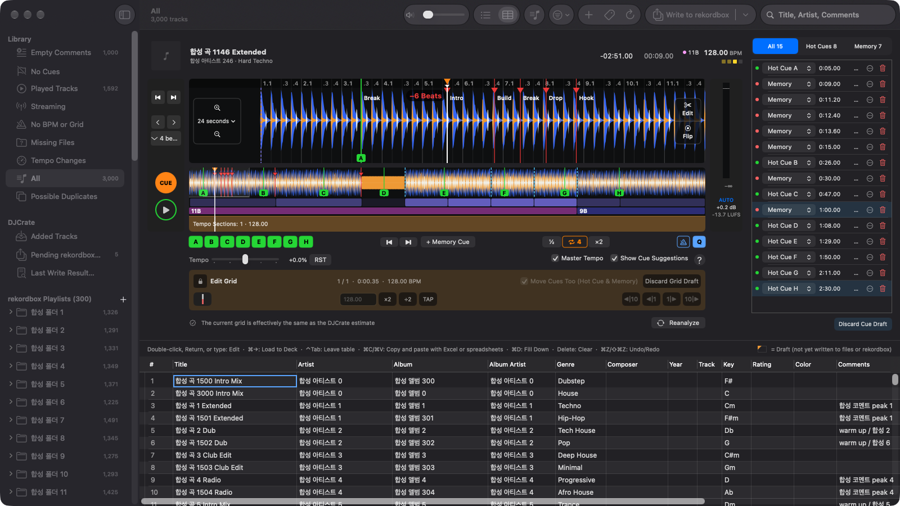

# DJCrate

[](https://github.com/fotoner/DJCrate/actions/workflows/check.yml) [](LICENSE)

[한국어](README.md) | [English](README.en.md) | [日本語](README.ja.md) | **简体中文**

> [!WARNING]
> DJCrate 目前仍处于 **测试版**（0.x）阶段，可能会出现意料之外的问题。
>
> DJCrate 在写入 rekordbox 之前，会自动备份整个资料库。如果写入后出现问题，请通过工具栏 [Write to rekordbox]（写入 rekordbox）菜单中的 [Restore Before Write…]（恢复到写入前）进行还原。如果问题仍然存在，请通过 [Issues](https://github.com/fotoner/DJCrate/issues) 联系我们。
>
> DJCrate 依据 [MIT 许可证](LICENSE)按“原样”提供。对于使用过程中发生的任何数据丢失或损害，开发者不承担责任。

DJCrate 是一款 macOS 应用，无需启动 rekordbox 即可编辑 rekordbox 7 资料库。它是资料库管理工具，而不是演出用软件。它还附带命令行工具 `djc`。

> [!NOTE]
> 应用界面只有韩语、英语和日语。在中文系统中，界面以英语显示。本文用方括号写出英语界面名称，首次出现时在括号中附上中文含义。文档（`docs/…`）、`djc` 的输出和 GitHub Issue 均为韩语，下文链接指向韩语文档。



## 安全原则

- 所有编辑都先保存为草稿。只有点击 [Write to rekordbox] 时才会写入 rekordbox，快捷键为 ⇧⌘E。
- rekordbox 或 rekordboxAgent 正在运行时，绝不写入。
- 只在已验证的版本（7.2.x）和数据库结构上写入。
- 写入前备份整个资料库，在一个事务中完成写入，然后重新读取进行校验。
- 可以通过 [Restore Before Write…] 还原。
- 只执行已逐字段确认与 rekordbox 中相同编辑结果一致的写入。其余写入一律阻止，并在界面上显示原因。



## 安装与运行

预先构建的应用（测试版，Apple Silicon）可在 [GitHub Releases](https://github.com/fotoner/DJCrate/releases) 下载。下载后的安装步骤见[发布文档](docs/releasing.md#설치)。

应用会自动检查新版本并提示。只有在验证签名后才会安装更新；正在写入 rekordbox 或 USB 时会推迟安装。可在 Settings › [Updates]（设置 › 更新）中选择自动检查与自动安装。v0.1.0 没有此功能，请手动下载并安装一次下一个版本。

从源码构建需要：

- macOS 27 或更高版本
- Swift 6.2 或更高版本（Xcode）
- rekordbox 7.2.x（已在 7.2.18 上验证）

```bash
git clone https://github.com/fotoner/DJCrate.git && cd DJCrate
scripts/build-app.sh --install        # /Applications/DJCrate.app
swift build -c release --product djc  # .build/release/djc
```

1. 点击工具栏中的 ⟳ [Sync with rekordbox]（与 rekordbox 同步），创建资料库的副本（快照）。快捷键为 ⌘R。此时 rekordbox 可以保持打开。
2. 在 Deck 和曲目列表中编辑。编辑过的曲目会带有待写入标记，并汇集到侧边栏的 [Pending rekordbox Writes]（待写入 rekordbox）中。
3. 完全退出 rekordbox 和 rekordboxAgent。
4. 点击 [Write to rekordbox]。DJCrate 会先在副本上试写。只有存在被阻止或被略过的内容时，才会先在确认对话框中列出这些项目；否则直接写入。
5. 如需还原，请点击结果通知中的 [Restore Before Write]（恢复到写入前）。

副本、草稿和备份保存在 `~/Library/Application Support/DJCrate/`。其中包含云端令牌，请勿分享。

## 功能

| 类别 | 功能 |
|---|---|
| 资料库 | 播放列表树、筛选（无 Cue、无网格、文件缺失等）、缺失文件的新位置候选（只读）、合并重复曲目、添加与移除曲目、iTunes 同步播放列表 |
| Deck | 三频段波形、CUE、Hot Cue 与 Memory Cue、采样级精度的 Loop、Quantize、速度调节与 Master Tempo（锁定调性）、节拍器、Auto Gain、Cue／网格／增益／调性建议 |
| 编辑 | Cue、网格与 BPM（包括变速曲目）、增益、标签、评分与曲目颜色、专辑封面。可像电子表格一样编辑的 [Tag Sheet]（标签表）。对于未分析的曲目，DJCrate 会生成并附加分析文件 |
| 曲目编辑与 Flip（实验性） | 将按小节剪接的编辑版本，或记录了 Hot Cue 跳转与 Loop 演奏的编辑版本渲染为 WAV，并加入资料库 |
| 播放列表 | 创建播放列表与文件夹、重命名、移动、删除、添加与移除曲目、调整顺序。可在侧边栏中按住 ⌘ 或 ⇧ 点击，一次删除或移动多个 |
| 播放历史 | 浏览播放历史，并由历史生成播放列表。保存 CDJ、XDJ 留在 USB 上的历史，再将其加入 rekordbox 的播放历史 |
| XML | 供 rekordbox 导入的联动 XML、整个资料库的 XML 导出（只读）、导入 rekordbox XML（先预览差异，再生成草稿）、导入 Apple Music XML |
| USB（实验性） | 读取、导出、编辑与同步 OneLibrary 和 Device Library；为旧 USB 添加 OneLibrary。只有在 [Export to USB]（导出到 USB）面板或写入确认对话框中确认写入后，才会写入实体 USB（写入前备份，写入后校验） |
| 还原 | 恢复到写入前、还原点（每天自动创建一次、与当前比较、还原到该时间点）、修复被阻止的草稿 |
| 更新 | 在 GitHub Releases 上查找新版本并提示，验证签名后安装。Settings › [Updates]（设置 › 更新） |
| 实验室 | 显示智能播放列表（只读）。在 Settings › [Labs]（设置 › 实验室）中开启 |
| CLI 与智能体 | 使用 `djc` 浏览资料库，并创建 Cue、标签与播放列表草稿。还提供 XML、USB 和还原点相关命令。适用于 Claude Code 与 Codex 的[技能](skills/djcrate/SKILL.md)和 `djc` 可在 Settings › [AI Agents]（设置 › AI 智能体）中安装与更新 |



## 文档

| 文档 | 内容 |
|---|---|
| [docs/features.md](docs/features.md) | 功能详情、限制、XML 流程、快捷键 |
| [docs/cli.md](docs/cli.md) | `djc` 命令与 JSON |
| [docs/rekordbox-internals.md](docs/rekordbox-internals.md) | 通过实验确认的 rekordbox 写入规则 |
| [docs/usb-internals.md](docs/usb-internals.md) | USB 格式与写入规则 |
| [docs/architecture.md](docs/architecture.md) | 架构与设计决策 |
| [CONTRIBUTING.md](CONTRIBUTING.md) · [AGENTS.md](AGENTS.md) · [docs/issues.md](docs/issues.md) | 构建与验证、工作规则、[GitHub Issue](https://github.com/fotoner/DJCrate/issues) 规则 |

## 许可证

- 采用 [MIT](LICENSE) 许可证。第三方声明见 [THIRD_PARTY_NOTICES.md](THIRD_PARTY_NOTICES.md)。
- rekordbox 是 AlphaTheta 的商标。本应用是与 AlphaTheta 无关的独立项目。
- rekordbox 数据库密钥的解密方式与 [pyrekordbox](https://github.com/dylanljones/pyrekordbox)（MIT）相同。
